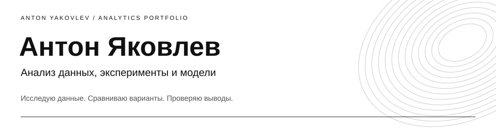

Здесь собраны семь моих проектов. В каждом — задача, мои действия, результаты и материалы для проверки расчётов.

## Проекты

| Работа | Задача | Материалы |
|---|---|---|
| **Анализ и визуализация данных** | Зарплаты в датасете вакансий | [Открыть →](https://github.com/antonislav11/data-analysis-vacancies) |
| **Вероятностное моделирование** | Вероятность оффера и проверка выводов | [Открыть →](https://github.com/antonislav11/probability-modeling) |
| **Анализ экспериментальных данных** | Сравнение биоугольных составов | [Открыть →](https://github.com/antonislav11/experimental-data-analysis) |
| **Сценарное моделирование** | Газосборная сеть в tNavigator | [Открыть →](https://github.com/antonislav11/scenario-modeling) |
| **Расчёт параметров и сравнение структур** | Геометрия углеродных нанотрубок | [Открыть →](https://github.com/antonislav11/parametric-modeling-nanotubes) |
| **Проектирование пользовательского сценария** | Погодный бот | [Открыть →](https://github.com/antonislav11/user-scenario-weather-bot) |
| **Численное моделирование и контроль точности** | Теплообмен на Python | [Открыть →](https://github.com/antonislav11/numerical-modeling) |

## Контакт

[antonakovlev82081@gmail.com](mailto:antonakovlev82081@gmail.com)
